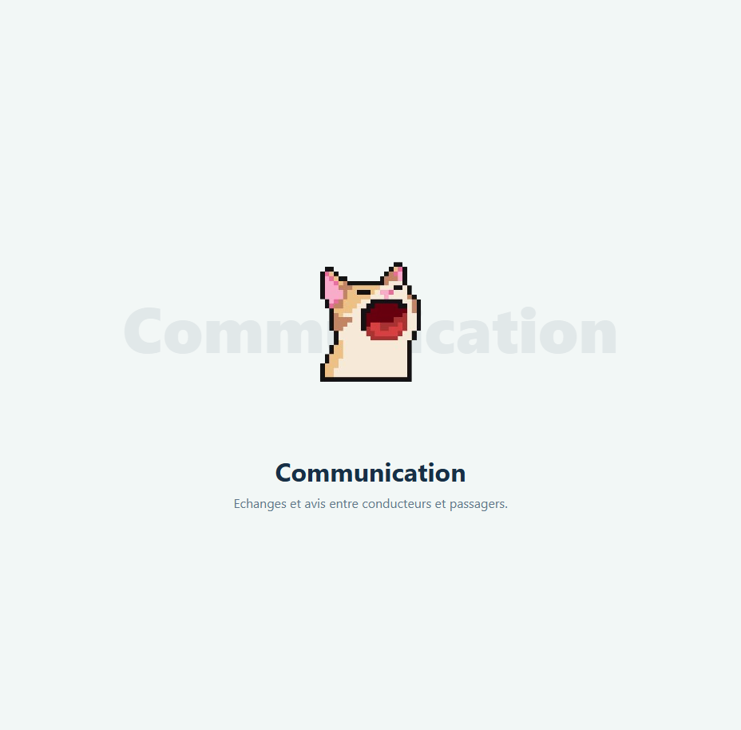

# Module 5 — Communication & feedback

**Owner:** Ahmed Ridha Lazhari · **Django app:** `communication` · **Branch:** `module-5-communication`
**Dependencies:** users, trips and reservations · **Used by:** user profiles and trip search
**Plan:** Sprint 1 — messages and reviews · Sprint 2 — live chat and rules · Sprint 3 — insult filter

## Features

- Open a private chat when a reservation is accepted; deliver messages in real time.
- Let trip participants review each other after a completed trip.
- Show average ratings and allow admins to moderate reviews.
- Filter abusive messages and reviews.

## Data and rules

- `Conversation`: one-to-one with a reservation; opened on acceptance.
- `Message`: conversation, sender, content (1–1000 characters), timestamp, read flag and soft-delete flag.
- `Review`: trip, reviewer, target, rating (1–5), optional comment (up to 500 characters) and date.

| Rule | Requirement |
|---|---|
| Chat access | Only the reservation's passenger and driver can read or send messages. |
| Chat lifetime | Close 24 hours after departure, or when the reservation is cancelled/refused. Check on send even if the closing job is delayed. |
| Message deletion | Only the sender may delete; show “Message deleted” to both participants. |
| Reviews | Allow only after a completed trip and only between people who travelled together. One review per reviewer/target/trip; no self-reviews. |
| Review edits | Only the reviewer may edit/delete; run edited text through the filter again. |
| Average rating | Show the average rounded to one decimal only after at least three reviews, with the review count. |
| Moderation | Admins may delete reviews but cannot read private chats. Recalculate averages after review changes. |
| Delivery | WebSocket messages should arrive in under one second. |

## Pages and live chat

`app_name = "communication"`:

| URL | Purpose |
|---|---|
| `/chat/`, `/chat/<id>/` | Conversation list and chat |
| `/ws/chat/<id>/` | Authenticated WebSocket for chat participants |
| `/chat/messages/<id>/delete/` | Sender deletes a message |
| `/trips/<id>/review/<user_id>/` | Create a review |
| `/reviews/<id>/edit/`, `/delete/` | Reviewer updates/removes a review |
| `/users/<id>/reviews/` | View rating and reviews |
| `/manage/reviews/`, `/manage/reviews/<id>/delete/` | Admin moderation |
| `/manage/reviews/export/<fmt>/` | PDF/CSV/Excel export |

Use Django Channels with a Redis channel layer and one group per conversation. Authenticate WebSocket connections with the session. Save messages before broadcasting; reconnecting clients fetch missed messages by timestamp. Update unread counts when the recipient opens the conversation.

## AI insult filter

`ai.filter_insults(text) -> bool` returns `True` when text must be blocked. Apply it before saving messages and review comments.

1. Normalize case, accents, repeated letters and common character substitutions.
2. Match whole words from an editable list covering French, Arabic, Tunisian dialect, Arabizi and English.
3. Optionally use an ML toxicity classifier with a configurable threshold.
4. On a match, show a clear rejection and store nothing.
5. If the ML model fails, use the word list; a model outage must not prevent normal messages.

## Stories

| ID | Outcome | Priority |
|---|---|---|
| 5.1, 5.8–5.9 | Private, real-time chat with automatic closure | Should |
| 5.2, 5.4–5.5 | Create/edit reviews and display ratings | Could |
| 5.3 | Delete own messages | Could |
| 5.6 | Admin moderates reviews | Should |
| 5.7 | Block abusive content | Should |
| 5.10 | Admin exports review reports | Should |

## Integration and checks

- Reservations opens a conversation on acceptance and enables reviews on completion.
- Users shows average ratings; trips displays driver ratings in search and details.
- Test participant-only access (including WebSockets), chat closure, message deletion, review eligibility/uniqueness, average visibility, moderation and abusive-text false positives.
- Verify reconnection and message recovery; pull requests are reviewed and chat/reviews work on mobile.

## Scaffold preview

The screenshot shows the shared placeholder page, not the completed communication and feedback features.

