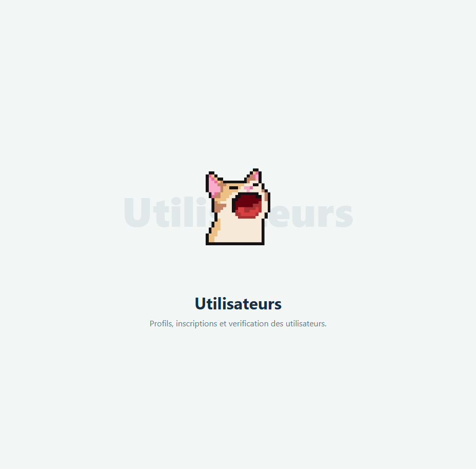

# Module 4 — Placeholder

**Owner:** _unassigned_ · **Django app:** `m4` · **Branch:** `m4`
**Dependencies:** _list other modules this one depends on_ · **Used by:** _list modules that depend on this one_
**Plan:** Sprint 1 — _core feature_ · Sprint 2 — _rules and edge cases_ · Sprint 3 — _polish / stretch goals_

## Features

- _List the main user-facing features this module provides._
- _List the roles or permission levels it introduces, if any._

## Data and rules

_Describe the models this module owns and the key constraints/validation rules._

| Rule | Requirement |
|---|---|
| _Rule name_ | _Requirement description_ |

## Pages

`app_name = "m4"`:

| URL | Purpose |
|---|---|
| `/` | Home |

## Stories

| ID | Outcome | Priority |
|---|---|---|
| 4.1 | _User story outcome_ | Must |

## Integration and checks

- _Describe how this module's data/views are consumed by other modules._
- _List what should be tested before merging._

## Scaffold preview

The screenshot shows the shared placeholder page, not completed module features.

