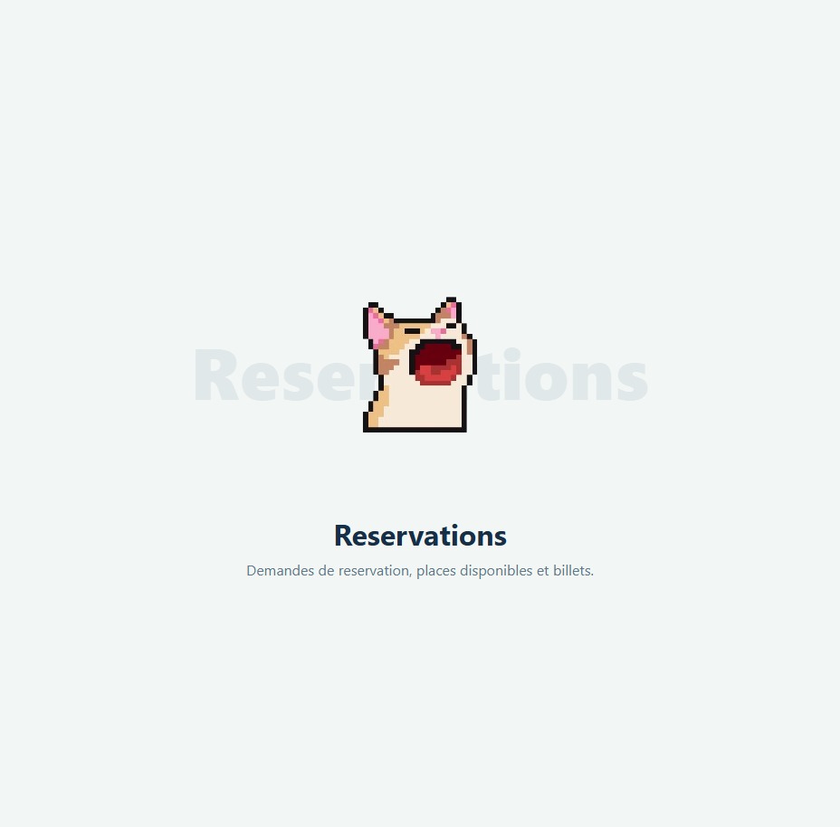

# Module 4 — Reservation management

**Owner:** Selim Aschi · **Django app:** `reservations` · **Branch:** `module-4-reservations`
**Dependencies:** users and trips · **Used by:** communication
**Plan:** Sprint 1 — booking flow · Sprint 2 — tickets, email and no-shows · Sprint 3 — recommendations

## Features

- Passengers request seats; drivers accept or refuse.
- Accepted bookings receive a QR ticket; drivers scan it at pickup.
- Support cancellations, no-show penalties, email notifications and recommended trips.
- Admins can search and export reservation records.

## Data and status flow

`Reservation` links a passenger to a trip and stores seat count, unique optional ticket code, creation time and status-change time. Statuses:

`PENDING → ACCEPTED → BOARDED → COMPLETED`

Other transitions: `PENDING → REFUSED | CANCELLED | EXPIRED`; `ACCEPTED → CANCELLED | NO_SHOW`. A trip cancellation cancels its active reservations. Hold seats when booking is requested; release them on refusal, cancellation or expiry.

## Rules

| Rule | Requirement |
|---|---|
| Booking | Request 1 or more seats no greater than remaining capacity; trip must be future and `OPEN`. Use a database transaction and row lock. |
| Eligibility | Passengers cannot book their own trip, duplicate active bookings, or book while `booking_blocked_until` is in the future. |
| Decision | Only the trip's driver may accept/refuse. |
| Cancellation | Passenger may cancel until 2 hours before departure. |
| QR ticket | Generate a unique, unguessable code on acceptance. Scan only for an `ACCEPTED` booking on that trip. |
| No-show | Driver may mark an absent passenger 15 minutes after departure. Three no-shows in the last 30 days block bookings for 7 days. |
| Privacy | Show the other user's phone number only while the booking is `ACCEPTED`. |
| Expiry | Pending requests at departure become `EXPIRED` and release seats. |
| Completion | When a trip completes, boarded reservations become `COMPLETED`, enabling reviews. |

## Pages

`app_name = "reservations"`:

| URL | Purpose |
|---|---|
| `/trips/<id>/book/` | Passenger requests seats |
| `/bookings/`, `/bookings/<id>/` | Passenger booking list and details |
| `/bookings/<id>/cancel/`, `/bookings/<id>/ticket/` | Cancel or view accepted ticket |
| `/driver/requests/`, `/driver/requests/<id>/accept/`, `/refuse/` | Driver decision flow |
| `/driver/trips/<id>/passengers/`, `/scan/` | Passenger list and QR scan |
| `/driver/reservations/<id>/no-show/` | Mark a no-show |
| `/recommended/` | Suggested trips |
| `/manage/reservations/`, `/manage/reservations/export/<fmt>/` | Admin list and export |

Passengers can access only their own bookings; drivers can access bookings for their own trips; admins can view and export all reservations. Check both role and ownership on every action.

## Notifications and recommendations

- Send email for new requests, acceptance (include QR ticket), refusal, cancellation and no-show. Email errors must be logged/retried without rolling back a booking.
- Use `qrcode` to generate tickets. Support browser camera scanning and manual code entry.
- `expire_pending_requests` expires unanswered requests at departure.
- `ai.recommend_trips(passenger, limit=5)` scores future open trips using past completed/boarded routes, weekday and hour. Exclude booked/full trips. For new users, show soonest trips from their last searched city instead.
- Booking should take at most three clicks from search results.

## Stories

| ID | Outcome | Priority |
|---|---|---|
| 4.1–4.3 | Book seats, decide requests and manage/cancel bookings | Must |
| 4.4–4.5 | Issue and scan QR tickets | Should |
| 4.6–4.7 | Handle no-shows and send email updates | Could / Should |
| 4.8 | Admin views reservations | Must |
| 4.9–4.10 | Recommend trips and export reports | Could / Should |

## Integration and checks

- Users supplies passenger/driver roles, no-show count and booking-block deadline.
- Trips supplies transactional seat methods and departure time; trip cancellation/completion updates reservations.
- An accepted booking opens a conversation; a completed booking enables a review.
- Test capacity under concurrent bookings, every status transition, the 2-hour rule, QR ownership/trip validation, no-show thresholds, email failure handling, role permissions and recommendation cold start.
- Pull requests are reviewed; the booking flow works on mobile.

## Scaffold preview

The screenshot shows the shared placeholder page, not the completed reservation features.

