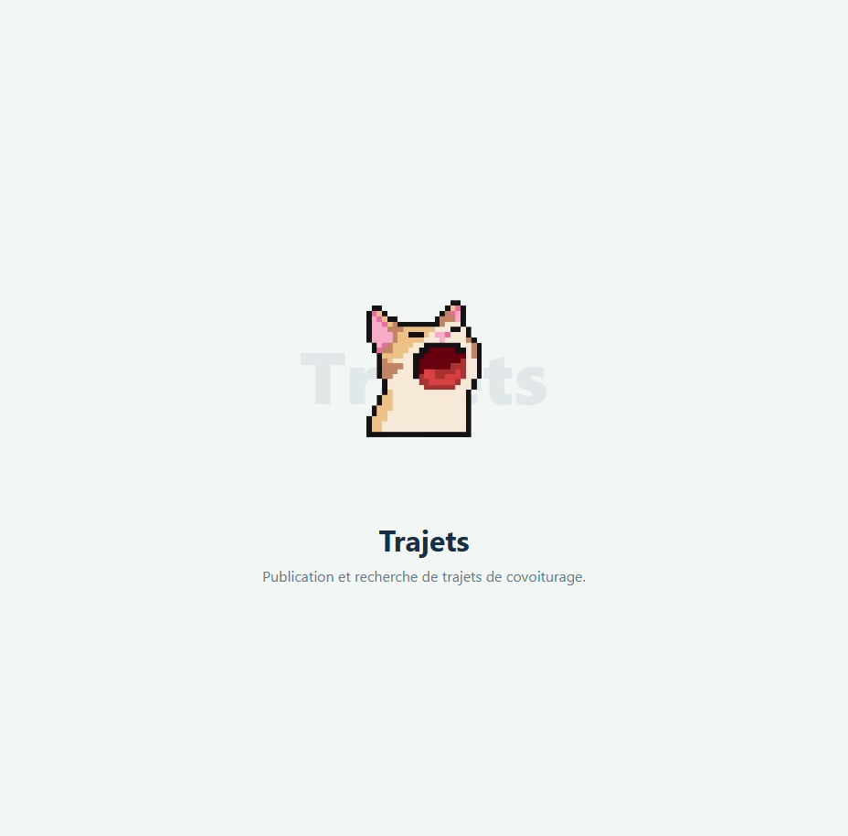

# Module 3 — Trip management

**Owner:** Wasim Snoussi · **Django app:** `trips` · **Branch:** `module-3-trips`
**Dependencies:** users and vehicles · **Used by:** reservations and communication
**Plan:** Sprint 1 — publish and search · Sprint 2 — routes and trip rules · Sprint 3 — price suggestion

## Features

- Drivers publish, edit and cancel trips; passengers search by route and date.
- Support intermediate stops, filters, sorting and an OpenStreetMap route.
- Suggest a fair price and cap the driver's price at 150% of the suggestion.
- Close full, cancelled and past trips; admins can manage and export trip data.

## Data and rules

`Trip` stores driver, accepted vehicle, departure/arrival cities and time, seats, remaining seats, price per seat, suggested price, distance, duration, route geometry and status (`OPEN`, `FULL`, `CANCELLED`, `COMPLETED`). `Stop` belongs to a trip and stores place, order and optional coordinates; stop order must be unique.

| Rule | Requirement |
|---|---|
| Publishing | Only a driver may publish, using their own accepted vehicle with valid documents. |
| Seats and date | Offered seats must be positive and no greater than vehicle capacity. Departure is 1 hour to 30 days ahead. |
| Driver schedule | Trips by the same driver must not overlap, using route duration. |
| Price | `price_per_seat <= 1.5 * suggested_price`; departure and arrival must differ. |
| Stops | Keep stops ordered; reject duplicate order and stops matching departure or arrival. |
| Edit | If reservations exist, route/date cannot change and seats cannot fall below seats already booked. |
| Cancel | Set trip to `CANCELLED`, cancel active reservations and notify passengers. |
| Availability | Search only future `OPEN` trips with seats. Zero remaining seats means `FULL`; released seats reopen the trip. Past trips become `COMPLETED`. |
| Concurrency | Change seat counts only through transactional `hold_seats(n)` / `release_seats(n)` using a row lock. |
| Search | Target response time is under 2 seconds; index route/date fields and paginate. |

## Pages

`app_name = "trips"`:

| URL | Purpose |
|---|---|
| `/trips/`, `/trips/<id>/` | Search results and trip details |
| `/trips/publish/`, `/trips/mine/` | Publish and manage driver's trips |
| `/trips/<id>/edit/`, `/cancel/` | Owner actions |
| `/trips/route-preview/` | Route and price preview |
| `/manage/trips/`, `/manage/trips/<id>/delete/` | Admin list and removal |
| `/manage/trips/export/<fmt>/` | PDF/CSV/Excel export |

Search includes intermediate stops and supports filters for price, seats and time, plus sorting by departure, price and driver rating. A map-service failure must not hide trip details. Do not show the driver's phone number on trip pages.

## Route and price services

- Use OSRM server-side with a short timeout to get distance, duration and route geometry; render with Leaflet and OpenStreetMap.
- If OSRM is unavailable, estimate straight-line distance and show a notice.
- Baseline per-seat price: `distance_km * consumption_L_per_100km / 100 * fuel_price_TND_per_L / (seats + 1)`, rounded to 0.1 TND. Consumption and fuel price are settings.
- `ai.suggest_price(distance_km, seats, vehicle=None) -> Decimal` may refine the baseline with historical accepted prices (distance, seats, day and time). Use the baseline until enough training data exists.
- Store `suggested_price` on the trip for the 150% cap check.

## Stories

| ID | Outcome | Priority |
|---|---|---|
| 3.1–3.3 | Publish, search, edit and cancel trips | Must |
| 3.4–3.6 | Filter/sort results, add stops and show the route | Should |
| 3.7 | Suggest a fair price | Should |
| 3.8 | Admin manages trips | Must |
| 3.9–3.10 | Hide full/past trips and export reports | Should |

## Integration and checks

- Vehicles provides vehicle capacity and accepted status; prevent vehicle deletion while trips use it.
- Reservations uses `hold_seats()`, `release_seats()` and trip cancellation/completion hooks.
- Communication uses completed trips to enable reviews and displays driver ratings.
- Test date/seat/price/overlap/stop validation, search visibility, seat concurrency, edit locks, cancellation cascade, auto-status changes and route-service fallback.
- Verify search performance against realistic data; pull requests are reviewed and the interface works on mobile.

## Scaffold preview

The screenshot shows the shared placeholder page, not the completed trip-management features.

