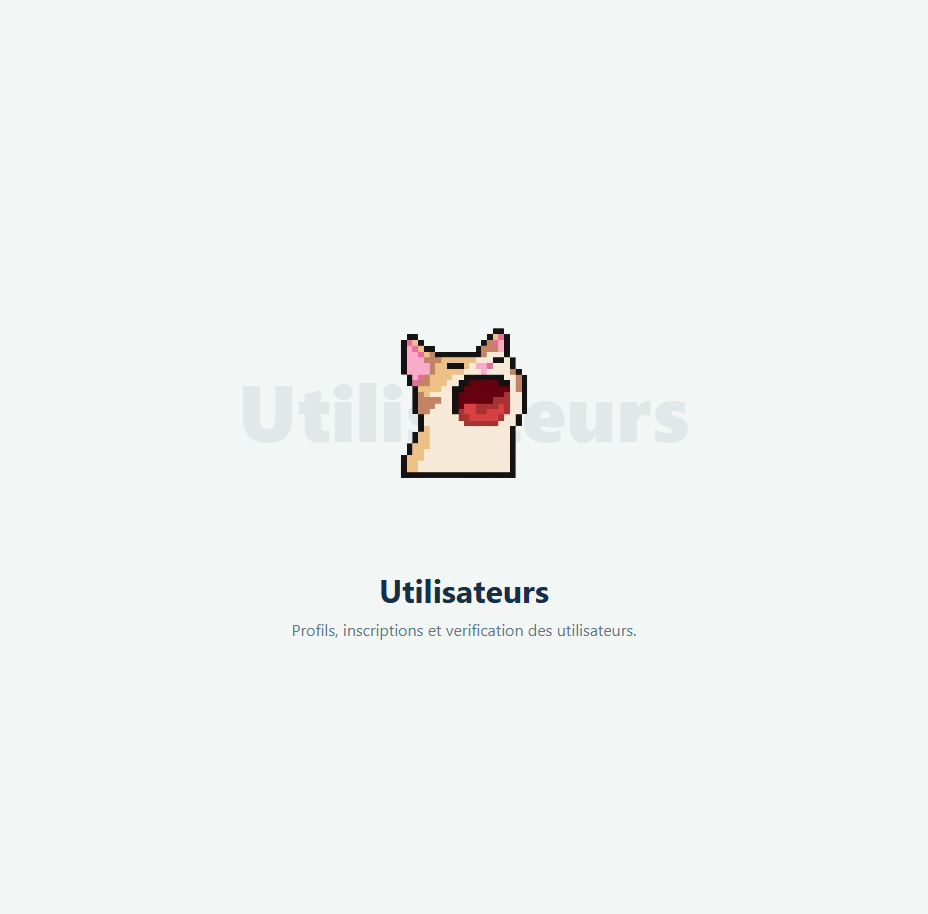

# Module 1 — User management

**Owner:** Alaaeddine Guouider · **Django app:** `users` · **Branch:** `module-1-users`
**Dependencies:** none · **Used by:** vehicles, trips, reservations and communication
**Plan:** Sprint 1 — accounts and profiles · Sprint 2 — account rules and reports · Sprint 3 — AI

## Features

- Sign up, log in/out, verify email, reset password, and view/edit/delete a profile.
- Roles: passenger, driver and administrator. A driver is a passenger with an accepted vehicle.
- Admin tools: search, filter, suspend and delete accounts; view suspicious accounts; export statistics.
- AI support: identity and photo checks, account risk score, and a help assistant.

## Data and rules

Use one concrete `User` model and proxy models for `Passenger`, `Driver` and `Administrator`. Set `AUTH_USER_MODEL = "users.User"` before the first migration.

`User` stores a unique email used as the login, birth date, phone, profile photo, account status (`UNVERIFIED`, `ACTIVE`, `SUSPENDED`), user type, identity verification flag, risk score (0–1), registration date, no-show count, booking-block deadline and driver-promotion date. Passwords use Django's hashing. `selfie` and `id_photo` are processed in memory and deleted after verification.

| Rule | Requirement |
|---|---|
| Age and email | Minimum age 18 at registration and profile edits; email is unique. |
| Email verification | Signed confirmation link expires after 24 hours. Unverified users cannot log in. |
| Login security | Five failed logins trigger a 15-minute lockout (`django-axes`). Suspended users cannot log in. |
| Identity checks | Selfie must match an ID card or passport. If AI is unavailable, send the account for manual review. |
| AI limits | AI may update `risk_score`, but must never suspend an account. Only an administrator may suspend it. |
| Admin safety | Administrators cannot suspend or delete themselves (proposed rule). |
| Privacy | Show a user's phone number only after a booking is accepted. |
| Account deletion | Require password confirmation; block deletion with upcoming trips/bookings, then delete or anonymise personal data. |

## Pages

`app_name = "users"`:

| URL | Purpose |
|---|---|
| `/` | Home |
| `/signup/`, `/verify-email/<token>/` | Registration and email verification |
| `/login/`, `/logout/` | Authentication |
| `/password-reset/` and Django reset-flow routes | Password recovery |
| `/profile/`, `/profile/edit/`, `/profile/delete/` | Profile management |
| `/assistant/` | Passenger help assistant |
| `/manage/users/` | Admin list, search and filters |
| `/manage/users/<id>/suspend/`, `/delete/` | Admin account actions |
| `/manage/users/suspicious/` | Accounts ordered by risk score |
| `/manage/users/stats/`, `/manage/users/export/<fmt>/` | Monthly statistics and PDF/CSV/Excel export |

Use a shared `UserTypeRequiredMixin` for protected views. Unauthenticated users go to login; users with the wrong role receive HTTP 403. Admin lists use pagination (10 per page).

## AI and reporting

- `verify_identity(selfie, id_photo) -> bool`: compare faces; delete both images after processing.
- `check_photo(photo) -> bool`: require one face and reject inappropriate content.
- `compute_risk_score(user) -> float`: consider account age, cancellations, no-shows, reports and duplicate phone/IP. Start rule-based; ML may follow.
- `assistant_answer(question) -> str`: answer from CoRide rules and decline unrelated questions.
- Model failure must not break sign-up or profile editing; route uncertain identity checks to manual review.
- Report new users by month and role; support PDF, CSV and Excel.

## Stories

| ID | Outcome | Priority |
|---|---|---|
| 1.1–1.2 | Register with identity documents and verify email | Must |
| 1.3–1.4 | Secure login and maintain a profile | Must |
| 1.5–1.6 | Recover password and delete an account | Should / Could |
| 1.7 | Admin manages accounts | Must |
| 1.8–1.10 | Check profile photos, flag risky accounts and answer help questions | Could |
| 1.11 | Admin views and exports account statistics | Should |

## Integration and checks

- Vehicles uses `User`; accepting a vehicle sets `user_type = DRIVER` and `became_driver_at`.
- Reservations reads and updates `no_show_count` and `booking_blocked_until`.
- Communication displays a user's average rating.
- Test age/email validation, verification expiry, lockout, suspended/unverified login, role permissions, account deletion guards, privacy, AI failure handling and the rule that AI cannot suspend users.
- Pull requests are reviewed; tests pass; forms and protected pages work on mobile; no secrets are committed.

## Scaffold preview

The screenshot shows the shared placeholder page, not the completed user-management features.

