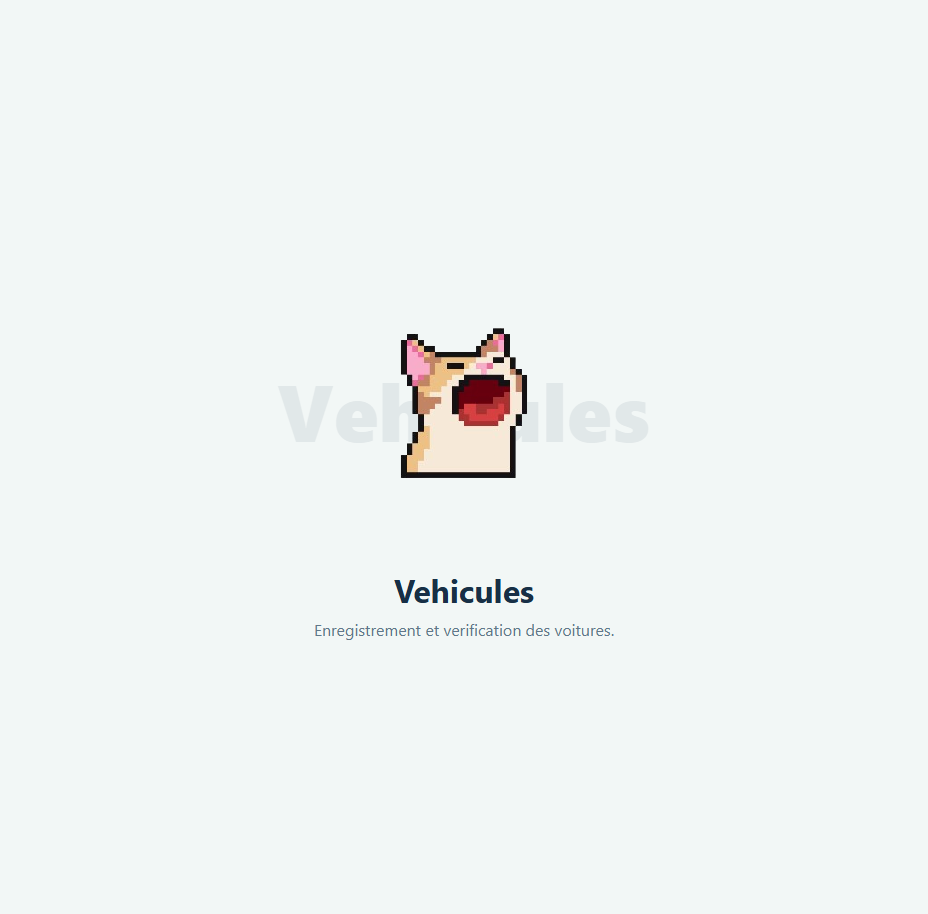

# Module 2 — Vehicle management

**Owner:** Abdallah Salhi · **Django app:** `vehicles` · **Branch:** `module-2-vehicles`
**Dependencies:** users · **Used by:** trips
**Plan:** Sprint 1 — vehicle records · Sprint 2 — validation and expiry rules · Sprint 3 — document OCR

## Features

- Drivers manage up to three vehicles and upload a license, registration and insurance document.
- Administrators review vehicles, accept or refuse them with a reason, and export reports.
- The first accepted vehicle promotes its owner to driver.
- OCR can read document numbers and expiry dates; users can correct the extracted values.

## Data and rules

`Vehicle` belongs to a user and stores brand, model, color, unique Tunisian plate, passenger seats, status (`PENDING`, `ACCEPTED`, `REFUSED`, `DOCUMENTS_EXPIRED`), refusal reason and creation time. `Document` belongs to a vehicle and stores type (`LICENSE`, `REGISTRATION`, `INSURANCE`), number, expiry date, file, status (`PENDING`, `VALID`, `EXPIRED`) and the last alert threshold sent. Allow one document per type per vehicle.

| Rule | Requirement |
|---|---|
| Limits | Maximum three vehicles per owner; exactly one of each required document. |
| Uploads | JPG, PNG or PDF, maximum 5 MB. Serve files through an owner/admin permission check, not public media URLs. |
| Plate | Validate Tunisian format (example `123 TUN 4567`), tolerate spaces, uppercase, and enforce uniqueness. Confirm any additional accepted formats with the team. |
| Expiry | Uploaded expiry dates must be in the future. Send email alerts at 30 and 7 days, without duplicates. |
| Validation | Only an administrator may accept/refuse; refusal requires a reason. Notify the owner by email. |
| Driver role | On the first accepted vehicle, set `user_type = DRIVER` and `became_driver_at`. |
| Edits | A plate or seat-count change on an accepted vehicle returns it to `PENDING` (proposed rule). |
| Expired documents | Mark the document `EXPIRED` and vehicle `DOCUMENTS_EXPIRED`; it cannot be used to publish a trip. Renewal requires admin re-approval. |
| Deletion | Block deletion while the vehicle is used by an `OPEN` or `FULL` trip. |

## Pages

`app_name = "vehicles"`:

| URL | Purpose |
|---|---|
| `/vehicles/`, `/vehicles/add/` | Owner's vehicle list and add form |
| `/vehicles/<id>/`, `/edit/`, `/delete/`, `/renew/` | Details and owner actions |
| `/vehicles/ocr/` | OCR prefill endpoint |
| `/manage/vehicles/` | Admin search and status filters |
| `/manage/vehicles/<id>/accept/`, `/refuse/` | Admin decision |
| `/manage/vehicles/export/<fmt>/` | PDF/CSV/Excel export |

Passengers and drivers can access only their own vehicles; administrators can review all. Check ownership on every action.

## OCR and scheduled work

`ai.read_document(file, doc_type) -> {"number": str | None, "expiry_date": date | None}` supports license, registration and insurance. The result only pre-fills the form. If OCR fails or is uncertain, leave fields empty, show a clear message, and allow manual entry. Always show the original document to the administrator.

Run `send_expiry_alerts` daily. Send one email at 30 days and another at 7 days before expiry; persist the last threshold to prevent duplicates. On expiry, update document and vehicle statuses.

## Stories

| ID | Outcome | Priority |
|---|---|---|
| 2.1–2.2 | Register a vehicle and receive an admin decision | Must |
| 2.3 | Edit/delete a vehicle subject to trip constraints | Must |
| 2.4 | Admin searches and filters vehicles | Should |
| 2.5–2.6 | Read documents and send expiry alerts | Should |
| 2.7–2.8 | Validate Tunisian plates and enforce the three-vehicle limit | Must |
| 2.9–2.10 | Renew documents and export admin reports | Should |

## Integration and checks

- Users module: promote the owner when their first vehicle is accepted.
- Trips module: only an accepted vehicle with valid documents can be used; prevent deletion while active trips use it.
- Test upload validation, required documents, plate uniqueness/format, owner and admin permissions, vehicle limits, accept/refuse transitions, renewals, alert deduplication and OCR failure fallback.
- Pull requests are reviewed; uploads are validated server-side; the flow works on mobile.

## Scaffold preview

The screenshot shows the shared placeholder page, not the completed vehicle-management features.

